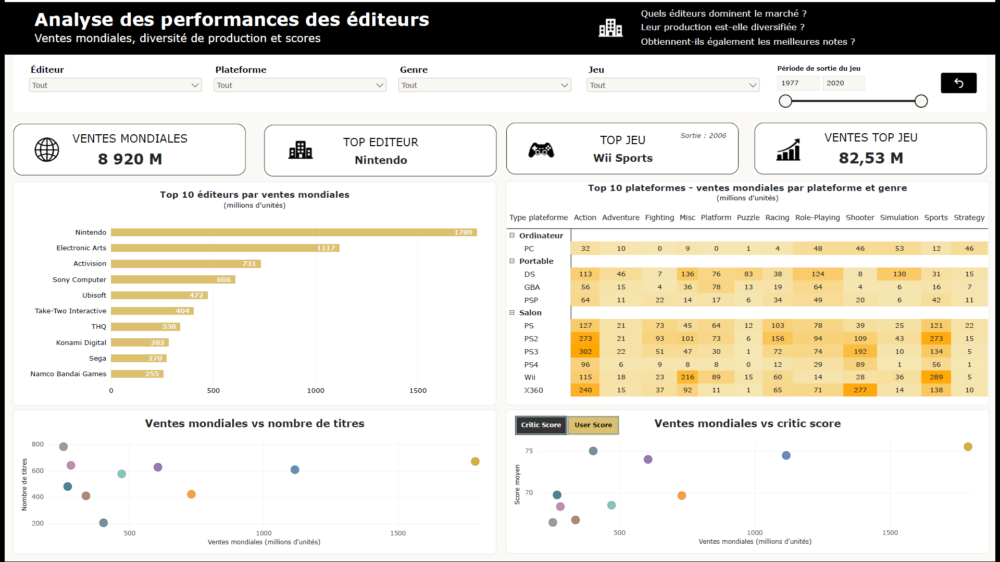
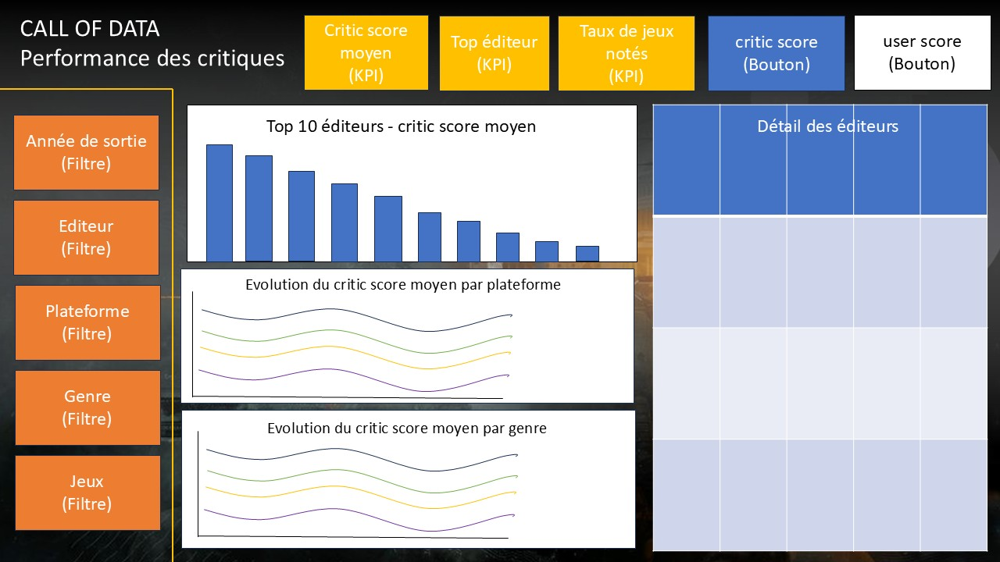
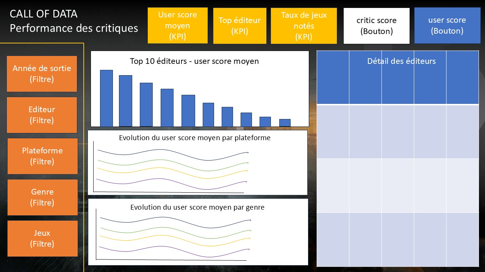

# 🎮 Analyse des performances des éditeurs de jeux vidéo (Projet Call of Data)

> Projet de fin d'études réalisé dans le cadre de ma formation **Data Analyst** chez **DataBird** : nettoyage et requêtage SQL sur BigQuery, tableau de bord interactif sous Power BI, gestion de projet et pitch de présentation.

---

## 🎯 Contexte & Problématique
Ce projet analyse les **performances des éditeurs de jeux vidéo** en croisant les volumes de ventes mondiales avec la réception critique (*Critic Score*) et celle des joueurs (*User Score*).

L'objectif est de fournir un outil d'aide à la décision complet, de l'audit des données brutes en SQL jusqu'à la restitution visuelle interactive sous Power BI.

---

## 🛠️ Stack technique
* **Exploration, nettoyage & analyse :** SQL sur Google BigQuery
* **Modélisation & Data Visualisation :** Microsoft Power BI (Power Query, DAX)
* **Conception & Restitution :** Maquettage (wireframes), présentation slides & démonstration vidéo

---

## 📂 Structure du dépôt
* `data/` : Jeux de données sources au format CSV (`plateformes.csv`, `ventes_scores.csv` et `ventes_scores_clean.csv`).
* `sql/` : Scripts SQL découpés en 3 étapes (`01_exploration.sql`, `02_cleaning.sql`, `03_analyse.sql`).
* `powerbi/` : Fichier source Power BI (`rapport_call_of_data.pbix`) et export statique (`rapport_call_of_data.pdf`).
* `presentation/` : Support de présentation métier (`presentation_projet.pdf`).
* `images/` : Captures d'écran du rapport final (`Power_BI_rapport_critic_score.jpg` et `Power_BI_rapport_user_score.jpg`) et maquettes de conception (`Maquette_bouton_critic_score.jpg` et `Maquette_bouton_user_score.jpg`).

---

## 🔍 Démarche analytique (SQL / BigQuery)
1. **Exploration & Contrôle qualité (`01_exploration.sql`) :**
   * Audit des tables `plateformes` (31 lignes, 0 valeur nulle, 0 doublon) et `ventes_scores` (16 719 lignes).
   * Calcul des taux de valeurs nulles par colonne, détection de faux doublons (conservés après vérification), contrôle des valeurs aberrantes (aucune vente négative, *Critic Score* entre 13 et 98, *User Score* entre 0 et 9,7) et vérification de l'intégrité référentielle via `LEFT JOIN`.
2. **Nettoyage & Modélisation (`02_cleaning.sql`) :**
   * Conversion de la colonne `Year_of_Release` du type `FLOAT64` vers `INT64`.
   * Après test d'une table dénormalisée (`call_of_data_complet`), choix d'architecture de conserver deux tables distinctes (`ventes_scores_clean` et `plateformes`) pour optimiser le modèle relationnel dans Power BI.
3. **Analyse métier (`03_analyse.sql`) :**
   * Classements des éditeurs, genres et plateformes par volumes de ventes et répartition géographique.
   * Comparaison entre succès commercial, notes critiques et notes utilisateurs, avec vérification systématique du taux de complétude des notes.

---

## 📊 Tableau de bord Power BI

### Aperçu du rapport final

### Accéder aux livrables Power BI
* 📄 **Consulter le rapport complet (PDF) :** [rapport_call_of_data.pdf](powerbi/rapport_call_of_data.pdf)
* 💻 **Télécharger le fichier source (PBIX) :** [rapport_call_of_data.pbix](powerbi/rapport_call_of_data.pbix?raw=true)

---

## 🎨 Conception & maquettes
Avant le développement sur Power BI, des maquettes ont été réalisées pour définir la hiérarchie des indicateurs et fluidifier la lecture métier.

  
Cliquez pour afficher les 2 maquettes initiales

   
  
  

---

## 🎤 Gestion de projet, présentation & vidéo de démonstration
* 📅 **Suivi & Diagramme de Gantt (Notion) :** [Consulter le planning du projet](https://fossil-tsunami-fbd.notion.site/8384876b2e2348c095ad337423d9df17?v=13d3d5976fba4ef68fc41c26ed2f8404&source=copy_link)
* 📑 **Support de présentation (Slides PDF) :** [presentation_projet.pdf](presentation/presentation_projet.pdf)
* 🎥 **Vidéo de présentation :** [Regarder la démonstration sur YouTube](https://youtu.be/uoevHEWN1L0)
---

## 💡 Principaux enseignements
* **Éditeur leader :** Nintendo domine les ventes mondiales avec 1789 millions d'unités vendues.
* **Corrélation ventes / notes :** Les éditeurs les mieux notés par la critique ne sont pas systématiquement les plus gros vendeurs en volume.
